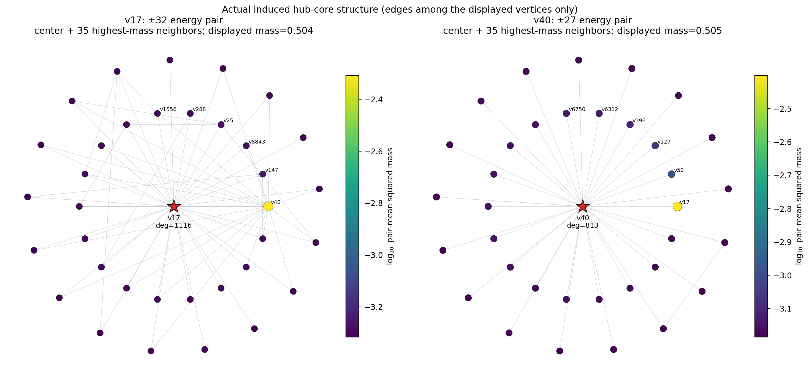
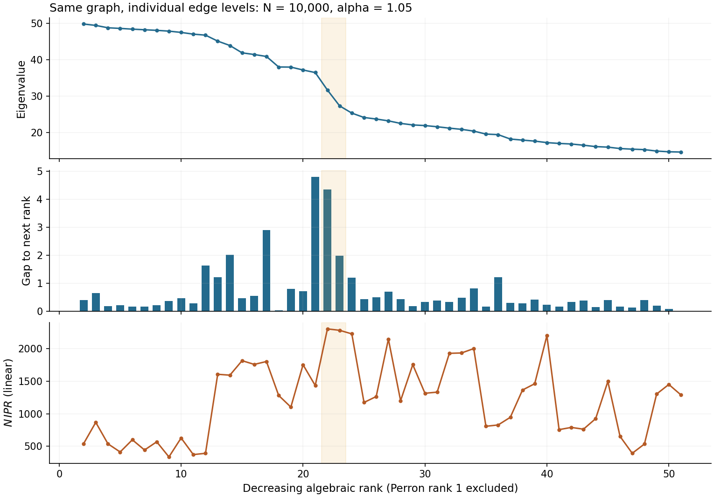

# Hub interactions and the tunneling test

[PA models](../models/preferential_attachment.md) · [Geometry](single_graph_geometry.md) · [Clean configuration](../../experiments/linear_pa_two_part_20260924/config.json)

## What the saved graph shows

In the N=10000, α=1.05 clean realization, vertices 17 and 40 have degrees
1116 and 813. They are adjacent and share 93 neighbors. Each supports a
positive/negative pair of strongly concentrated outer modes:

| Center | Negative energy | Positive energy | Overlap of the pair's mass distributions |
|---|---:|---:|---:|
| 17 | −31.83259754 | 31.61953955 | 0.921223 |
| 40 | −27.64228095 | 27.26606710 | 0.922372 |

Each focal vector places about 48% of its mass on its hub and about 93%
within distance one. The graph is not bipartite, so the energies need not be
exactly ± paired. These vertex IDs belong only to this saved realization.

For pᵢ=|ψᵢ|² and qᵢ=|φᵢ|² the overlap statistic is

$$O_{\min}(p,q)=\sum_i\min(p_i,q_i)
=1-\tfrac12\sum_i|p_i-q_i|.$$

The mass cosine is (p·q)/(‖p‖‖q‖). It is ≈0.99981 and 0.99980 for the two
same-hub sign pairs. Their signed inner products are numerically zero,
consistent with orthogonality of distinct eigenvectors of a symmetric matrix.

The overlap **between the two positive modes on different hubs** is only
≈0.10515, and their energy separation is ≈4.35347. Large same-hub ± overlap
must not be described as large overlap between two neighboring positive levels.
[The sign-pair table](../results/latest_summary_tables/hub_pair_overlap.csv)
keeps the compared eigenpair IDs explicit.

## Star scale and the nonmonotone edge

For an isolated star with d leaves, let c be the hub amplitude and b the
common leaf amplitude. Eb=c and Ec=db imply E²=d. Normalization gives
c²=1/2, b²=1/(2d), and IPR=1/4+1/(4d). The ± modes have identical masses
despite their opposite leaf signs. This explains why same-hub sign pairs are
a useful structural comparison; a real PA hub also has connections beyond
the star, which the residual audit must test.

Descending-edge gaps in the audited graph include ≈0.02701 between ranks
18–19, ≈4.80273 between 21–22, ≈4.35347 between 22–23, and ≈1.98534 between
23–24. Neither the spacings nor N·IPR vary monotonically with rank.

Discrete hub degrees and different local neighborhoods give distinct local
energy scales. Their gaps can become large and then small again. Coupling
can modify them further. The observed nonmonotonicity does not, on its own,
identify a particular gap as a tunneling splitting.

## Reduced operators and acceptance tests

For candidate local modes Φ, form the Gram matrix G=ΦᵀΦ. After removing
dependent directions, symmetric orthonormalization gives B=ΦG^{−1/2}, and

$$H_{\mathrm{eff}}=B^TAB,\qquad
R=(I-BB^T)AB.$$

Projected energies are tested against the full eigenpairs, along with
captured subspace mass and residual leakage. The code keeps exact-vector-
informed region selection explicit: this is an a-posteriori explanation test.

A spatial two-mode model has

$$H_2=\begin{pmatrix}\epsilon_1&t\\t&\epsilon_2\end{pmatrix},\qquad
E_+-E_-=\sqrt{(\epsilon_1-\epsilon_2)^2+4t^2}.$$

The splitting is 2|t| only at resonance, ε₁=ε₂. The two states must first be
valid localized reference modes with sufficiently small leakage; connecting
two high-degree vertices is not that validation.

For a retained subspace P and complement Q, the energy-dependent Schur
operator is

$$H_{PP}+H_{PQ}(E-H_{QQ})^{-1}H_{QP}.$$

It requires a well-defined resolvent at the tested energy. The implementation
checks isolation and residuals instead of treating this correction as valid
through a pole.

## Recorded outcome

The clean grid contains 14 graphs: N=500,10000 and seven α values, m=10.
There were 1568 adjacent-pair targets (95 per small graph, 129 per large
graph), 1386 targets with some reference dictionary, and 12342 diagnostic
rows across sensitivities. Only one full-dictionary row passed acceptance,
at N=10000, α=1.5. It was multimode. **No spatial two-mode row passed, and
no Schur row qualified for continuation.** The strict mass-informed reference
setting (x,y,R)=(0.80,0.20,2) produced no eligible dictionary.

Thus tunneling remains a hypothesis for the non-Poisson edge statistics, not
a demonstrated explanation of them. A Poisson comparison also requires the
same window and atom policy and enough within-graph gaps; localization alone
does not establish Poisson statistics.

## Code and reproduction

The scientific paths under `src/small_world_mobility_edge/` are
`preferential_attachment/linear_pa_two_part.py` and
`random_schrodinger/{geometry,tunneling,tunneling_correction,handoff_execution}.py`.
The frozen thresholds are in the clean configuration and
[`experiments/pa_coupling_and_anderson_20260924/`](../../experiments/pa_coupling_and_anderson_20260924/).
See [Hoffman commands](../hoffman_reproduction.md) for the production pipeline
and the [anatomy script guide](../../tools/pa_spectral_anatomy/README.md) for
regenerating the actual-hub plots from caches.
