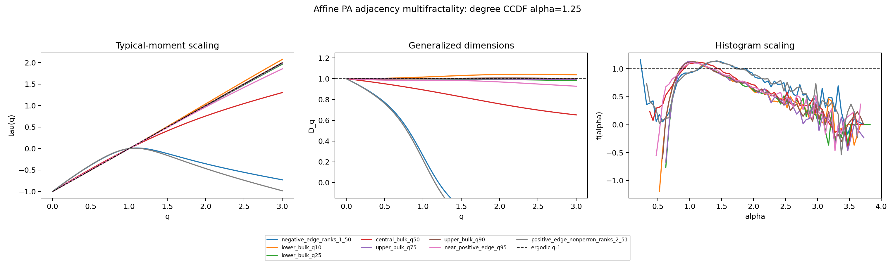

# PA multifractality: method and finite-size results

[PA models](../models/preferential_attachment.md) · [Production config](../../experiments/pa_multifractality_20261021/config.json) · [Recorded curves and tables](../results/pa_multifractality/)

## Which paper supplies which idea?

[Bueno and Hatano, arXiv:2007.00129](https://arxiv.org/abs/2007.00129) studies
structural null-eigenvalue localization. It does not supply the multifractal
size-scaling protocol.

[Tapias and Sollich, arXiv:2311.15808](https://arxiv.org/html/2311.15808v1)
studies heterogeneous weighted random networks in a high-connectivity limit,
using a negative-binomial configuration ensemble and Gaussian couplings.
Its multifractality occurs around a density singularity **inside the bulk**,
near zero. This is not a PA model, nor evidence that multifractality occurs
only at an outer mobility edge. A divergent density means crowded levels;
it is not a criterion identifying every small-gap pair as multifractal.

The explicit numerical recipe used for this implementation is
[Appendix C of da Silva, Tapias, Sollich, and Metz, arXiv:2408.13322v2](https://arxiv.org/html/2408.13322v2#A3):
50-state bands, typical generalized moments, Δq=0.02, a two-size exponent
estimate, and a histogram-based singularity spectrum. Their operator is a
weighted Laplacian; ours remains raw PA adjacency. Their moment analysis
uses 128 and 64 matrix instances at N=2¹⁴ and 2¹⁵. Our reused PA cache has
one graph per size and α. We transfer the observables, not their ensemble or
the strength of their inference.

## Implemented observables

Let pᵢ=|ψᵢ|² with Σpᵢ=1. For each configured band,

$$I_q=\sum_i p_i^q,\qquad
L_q(N)=\langle\log I_q\rangle_{\mathrm{band}},\qquad
I_q^{\mathrm{typ}}=\exp L_q.$$

The code evaluates q=0,0.02,…,3 using log-sum-exp, and also exports arithmetic
means for comparison. Its q=0 convention is I₀=N, including exact-zero
coordinates; it is not a nonzero-support counter. I₁=1 and I₂ is IPR.

$$\widehat\tau(q)=-\frac{L_q(N_2)-L_q(N_1)}{\log N_2-\log N_1},\qquad
\widehat D_q=\frac{\widehat\tau(q)}{q-1}\quad(q\ne1).$$

At q=1, use the slope of the band-mean Shannon entropy
S=−Σpᵢ log pᵢ against log N. Uniform states give τ(q)=q−1 and Dq=1;
point-localized states give τ(q)=0 for q>0. Nonlinear τ(q), stable under
size and window controls, is the scale-dependent evidence sought here.
An evenly spread top-20 core at one N cannot determine those exponents.

To avoid confusing the degree exponent α with an amplitude exponent, write
ηᵢ=−log pᵢ/log N. The output CSV calls this latter quantity `alpha_center`.
Its histogram density Ω_N gives

$$\widehat f_N(\eta)=1+\frac{\log\Omega_N(\eta)}{\log N}.$$

The cross-size alternative is 1+slope(log Ω_N versus log N), using bins
populated at both sizes. Histogram η edges are 0…6 in steps of 0.05;
log₁₀(Np) edges are −16…4.5 in steps of 0.1. Overflow fractions are
exported; zero coordinates are floored numerically for logs. Changing from
the Np density to the η density introduces a log-N Jacobian, so finite-size
histogram conventions must be kept consistent. The code uses direct
histograms, not an independently estimated Legendre transform.

Each selected eigenvector also records N·IPR, Shannon entropy, M₂₀,
top-r evenness M_r²/(r Σ_{top r}pᵢ²), top-1%-degree mass, adjacency of the
two largest-mass vertices, neighboring gaps, and the minimum gap divided by
the median resolved gap in a ±25-index neighborhood. “Resolved” means above
the numerical tolerance; the raw minimum can still be zero. The recorded
Spearman correlation filters nonpositive/nonfinite gaps but does not remove
all flagged clusters. Tiny numerical splittings inside a repeated block can
therefore enter that descriptive statistic; it is not a basis-invariant
localization diagnostic.

## The actual PA design

- Reuse the 14 clean eigensystems: N∈{500,10000}, m=10,
  α∈{1.05,1.1,1.25,1.5,2,2.5,3}, δ=10(α−2), one graph per condition.
- Eight 50-state windows: quantile centers 0.10,0.25,0.50,0.75,0.90,0.95;
  lowest ascending ranks 1–50; highest descending ranks 2–51, excluding Perron.
- Quantiles refer to the **full spectrum**, including the zero atom. A fixed
  count of 50 occupies 10% of the small spectrum but 0.5% of the large one.
  Quantile centers are matched; relative window widths and edge depths are not.
- Adjacent gaps within 64·ε_machine·N·max(1,max|E|) form numerical clusters.
  Cluster vectors are flagged as basis-ambiguous. They remain in the recorded
  band moments; the flag must be consulted before interpreting those moments.
- The production layout supports one cached case per (N,α). It is not an
  ensemble-replication driver. Overlapping windows are not independent samples.

## Recorded result

At α=1.25 the central band gives D₀.₅≈0.9516, D₁≈0.8927, D₂≈0.7579,
and D₃≈0.6518. This is a nondegenerate, finite-size candidate signature.
For α≥1.5, central D₂≈0.981–0.996 is much closer to the ergodic reference.



At α=1.05 the central bands contain 50 ambiguous vectors at each size; at
α=1.1 the counts are 47 and 50. Those curves largely characterize a chosen
zero-eigenspace basis. The upper-edge two-size D₂ estimates range from about
−0.466 to 0.119. Negative estimates mean that IPR increased between the
selected windows, not that an asymptotic support dimension is negative.
Window drift is substantial here. Two sizes with one graph each provide no
graph-ensemble error bars, and a two-point fit's R²=1 is not a fit-quality test.

The next inference step is graph replication at more sizes with matched
spectral selection, separating zero, near-zero nondegenerate, shoulder, and
outer-edge states. This repository update does not run that new ensemble.

## Reproduce without the large eigenvector caches

The checked-in case tables suffice to rebuild every aggregate curve:

```bash
python3 tools/hoffman_pa_multifractality.py \
  --config experiments/pa_multifractality_20261021/config.json aggregate \
  --output-root docs/results/pa_multifractality/cases \
  --report-dir outputs/pa_multifractality_rebuilt
```

To recompute the per-vector statistics, supply the original clean case cache:

```bash
python3 tools/hoffman_pa_multifractality.py \
  --config experiments/pa_multifractality_20261021/config.json case \
  --alpha 1.25 \
  --source-root external_data/linear_pa_two_part_20260924_v3/cases \
  --output-root outputs/pa_multifractality/cases
```

Each `N_<N>/alpha_<slug>/` source requires `spectral_cache_manifest.json`
and `arrays/{graph_edges.npz,full_eigenvalues_ascending.npy,full_eigenvectors_ascending.npy}`.
The graph archive uses `n`, `edge_u`, `edge_v`, `degrees`; eigenvectors are
columns aligned to the ascending eigenvalues. The analyzer checks shapes,
finite ordered levels, and finite nonzero selected vectors. It trusts the
upstream cache identity for graph/eigensystem provenance; it does not rerun
the full eigenpair residual audit. Aggregate validation rejects mixed
configuration hashes, missing cases, and unexpected case identities.

For a bounded fresh-graph check: `make smoke-multifractality`. For Hoffman,
activate a Python ≥3.11 environment, then set absolute paths and submit:

```bash
export PA_MF_PROJECT_ROOT="$PWD"
export PA_MF_SOURCE_ROOT="/path/to/clean-run/cases"
export PA_MF_RUN_ROOT="/path/to/new-mf-run"
export PA_MF_PYTHON="$(command -v python3)"
bash tools/hoffman_submit_pa_multifractality.sh
```

The wrapper submits validation → one array task per α → aggregation. Each
case task verifies validation success before reading caches. No graph is
regenerated and no eigensolver runs in this cached-analysis workflow.
