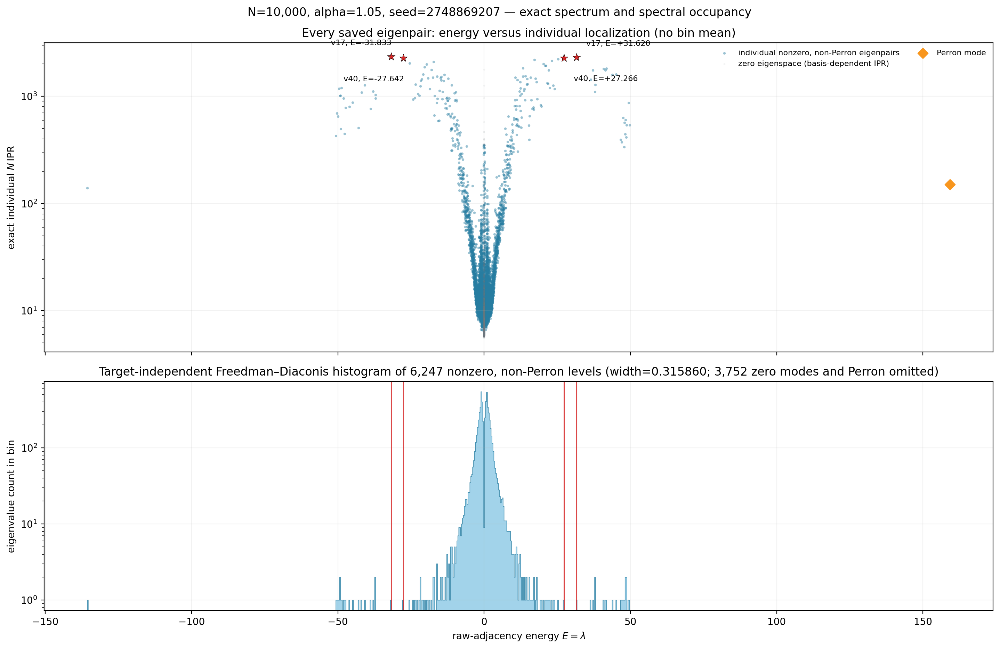
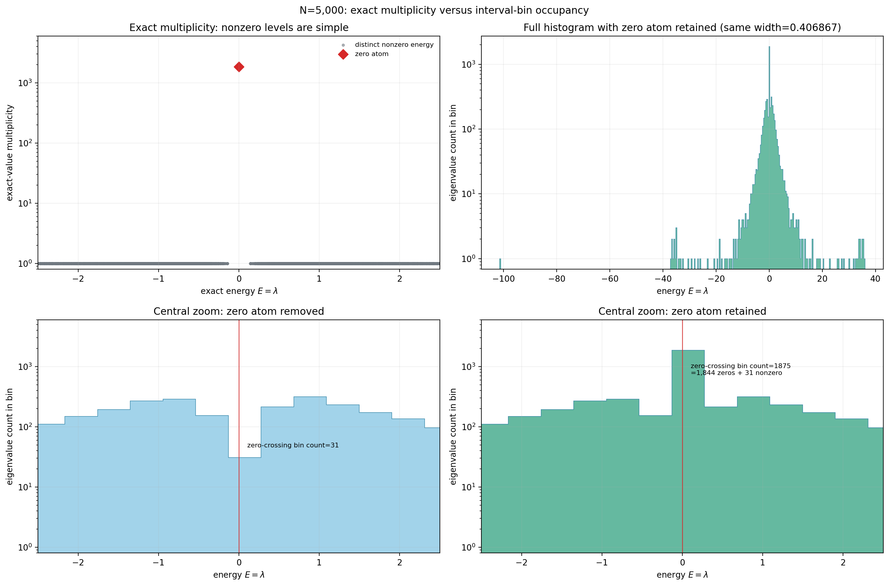
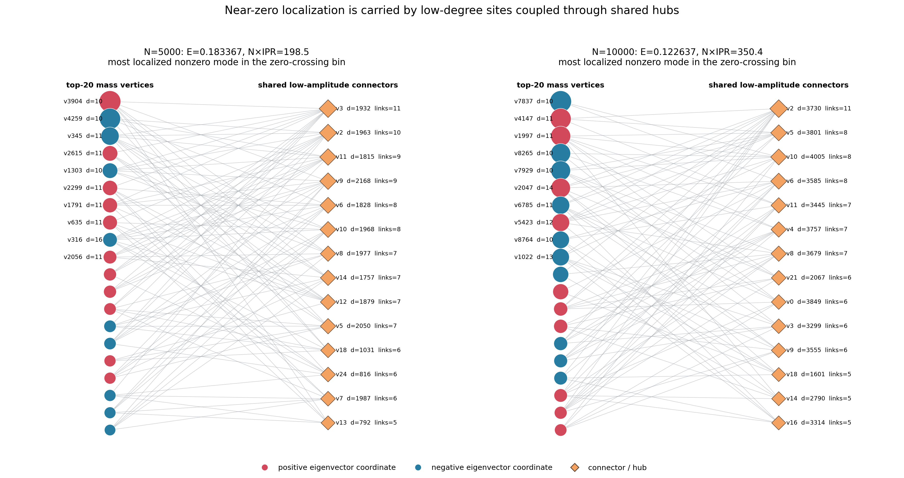

# Single-graph spectral geometry

[PA models](../models/preferential_attachment.md) · [Hub interactions](hub_interactions.md) · [Reproduction scripts](../../tools/pa_spectral_anatomy/README.md)

## What changed from ensemble statistics

Earlier ER/Chung–Lu analyses estimated an aggregate density or reference CDF
from multiple realizations. The paired fixed-degree studies retained per-graph
gaps before aggregation. The dedicated PA geometry study goes further: each
displayed level, IPR, mass set, and induced subgraph refers to **one saved
graph and its eigenvectors**. This is not a histogram of pooled eigenvalues.
An independently estimated CDF can still unfold gaps within that single graph.

The three-model production uses N=5000, m=10, affine α=1.05, affine α=2,
and nonlinear ζ=1.5. Exact settings, seeds, edge ranks, bulk windows, and
held-out CDF inputs are in the [production configuration](../../experiments/single_graph_edge_bulk/production_models.json).
The later clean affine grid uses N=500 and 10000 and seven α values, not the
same size grid. Its upper-edge window is decreasing ranks 2–51, its lower edge
is the lowest 50 levels, and its full-spectrum bulk window is 40–60%.

## Audited α=1.05 realizations

| Quantity | Earlier single graph | Later clean graph |
|---|---:|---:|
| N | 5000 | 10000 |
| Graph seed | 4011773341 | 2748869207 |
| Edges | 49945 | 99945 |
| Degree range | 10–2168 | 10–4005 |
| Numerical zeros, absolute tolerance 10⁻⁸ | 1844 | 3752 |
| Nonzero, non-Perron levels | 3155 | 6247 |

These are different graphs. All vertex labels below are zero-based.

## Density, gaps, and degeneracy

For a retained sample of M levels, a histogram bin B has mass n_B/M and
density n_B/(M |B|). A high bar can contain many **distinct** levels. It is
not an eigenvalue multiplicity. The audit tests bin width, bin origin,
fixed-interval mass, empirical CDF/rank plots, and tie-aware quantile bins.
Keeping the sample and denominator fixed separates spectral structure from a
display artifact. Removing the zero atom changes the conditional distribution
and its denominator; zero-retained and zero-removed plots are labeled separately.

The N=10000 positive shoulder near +1 contains 536 distinct levels in a
width ≈0.315860 interval. Its minimum gap is ≈0.000033, median gap ≈0.000483,
and median N·IPR ≈13.44. The zero-crossing bin, after removing exact zeros,
contains only nine levels, has minimum gap ≈0.003372, and median N·IPR ≈300.4.
Thus the densest near-bulk shoulder is **not** the most concentrated near-zero
group. Small raw gaps and localization must be measured separately.

## Eigenvector geometry

For a normalized vector ψ define pᵢ=|ψᵢ|² and sort p in descending order:

$$\mathrm{IPR}=\sum_i p_i^2,\quad
\mathrm{PR}=\frac1{\mathrm{IPR}},\quad
\mathrm{PF}=\frac1{N\mathrm{IPR}},\quad
M_r=\sum_{j=1}^r p_{(j)},\quad
K_c=\min\{k:M_k\geq c\}.$$

The top-r induced subgraph keeps only selected vertices and edges between
them. Distances and shells are instead measured in the **full original
graph**, allowing paths through vertices outside the top-r set. For center v,
shell mass is Σ_{dist(v,i)=ℓ}pᵢ and ball mass is its cumulative sum up to radius R.
Two top-mass vertices can have no edge inside their induced subgraph yet share
many external neighbors.

The nine N=10000 nonzero zero-crossing modes have median M₂₀≈0.671 and median
half-mass support 12. The two shoulders have median M₂₀≈0.102–0.103 and
half-mass support ≈334–338. The code additionally measures neighborhood
similarity and signed contributions at external connectors.

At a connector b, (Aψ)_b=Σ_{i∼b}ψᵢ=Eψ_b. Opposite **signed amplitudes** can
cancel; squared masses cannot. Equal neighborhoods can yield exact null
vectors, while imperfect matching can support near-null structures. The
diagnostics evaluate these sums directly. Small |E| by itself does not imply
localization.

For a region S and normalized truncation u supported on S, the leakage test is

$$\|(A-E)u\|^2=\|(A_{SS}-E)u_S\|^2+
\|A_{S^cS}u_S\|^2.$$

High captured mass alone does not make u an approximate eigenvector: the
outside term can remain large. The audit tabulates both terms for mass-ranked
sets and graph balls, with a separate operational compactness cap.

## Repeated eigenspaces

Individual solver vectors in a repeated eigenspace are basis-dependent. If
the columns of U span the zero eigenspace, P₀=UUᵀ and its diagonal are
basis-invariant. Normalize the diagonal by tr(P₀) to compare its distribution
over vertices. A seeded null vector P₀e_v/‖P₀e_v‖ is also basis-independent
when the denominator is nonzero. These quantities describe the subspace, not
the localization of an arbitrarily rotated basis vector. The projector and
projected-potential routines are in `random_schrodinger/zero_subspace_correction.py`.

The distinction is relevant to [Bueno and Hatano's null-eigenvalue localization
study](https://arxiv.org/abs/2007.00129), which concerns structural null modes
and quantum walks, not the finite-size multifractal protocol used here.

## Data and computation

- [Exact N=10000 levels](../results/latest_summary_tables/n10000_individual_levels.csv) and [N=5000 levels](../results/latest_summary_tables/n5000_individual_levels.csv).
- [Near-zero/shoulder summaries](../results/latest_summary_tables/nearzero_structure.csv).
- [Histogram sensitivity, mass sets, shell mass, and leakage tables](../results/pa_spectral_anatomy/).
- Generator/geometry pipeline: `preferential_attachment/single_graph_edge_bulk.py`; cache audit: `tools/audit_pa_noncentral_targets.py`; later plots and near-zero analysis: `tools/pa_spectral_anatomy/`.

Paths under `src/small_world_mobility_edge/` are abbreviated above. The
[script guide](../../tools/pa_spectral_anatomy/README.md) distinguishes
cache-only audits from optional sparse recovery of unsaved eigenvectors.
